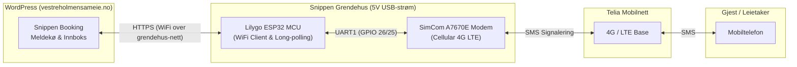

# Plan for Produksjonssetting av Snippen SMS Gateway

Dette dokumentet beskriver den fullstendige planen, evalueringen og sjekklisten for å sette Snippen SMS Gateway (Lilygo T-Call A7670E) i skarp produksjon på Snippen grendehus.

---

## 1. Systemarkitektur i Produksjon

SMS-tjenesten kjører som en frittstående IoT-enhet (Lilygo T-Call A7670E med ESP32 og 4G LTE-modem) koblet direkte til strømnettet på Snippen grendehus:



- **Ingen ekstern server/Raspberry Pi:** Mikrokontrolleren håndterer WiFi, HTTPS-kommunikasjon mot WordPress og 4G-modemet direkte.
- **Forretningslogikk:** Ligger i `snippen-booking` på WordPress. Mikrokontrolleren fungerer som en ren transport- og meldingsbro.

---

## 2. Evaluering av Tidligere Tasks

| Issue | Tittel | Evaluering & Status |
| :--- | :--- | :--- |
| **#86** | *Avbryt bakgrunnstilkobling ved BLE-oppstart og WiFi-skann* | **Lukket** (Duplikat av #87, løst via PR #88). |
| **#29** | *SIM7600G-H SMS provider* | **Lukket** (Erstattet av frittstående Lilygo T-Call A7670E-arkitektur, #49-#51). |
| **#35** | *Operational logging and diagnostics* | **Lukket** (Implementert via circular log buffer i `firmware/logger.py`, BLE log stream og serial monitor). |
| **#31** | *Protect outgoing SMS from loops and excessive sending* | **Aktiv** – Må løses i firmware (rate limiting & circuit breaker). |
| **#32** | *Prevent duplicate SMS delivery* | **Aktiv** – Løst i Python og mid-batch (#137), forsterkes med lokal sent-buffer i firmware. |

---

## 3. Forutsetninger og Nødvendige Komponenter

### Maskinvare
- [x] 1 stk. **Lilygo T-Call A7670E** (ESP32 med SimCom A7670E LTE-modem).
- [x] 1 stk. **4G/LTE-antenne** (IPEX/u.FL-kontakt koblet til MAIN antenneport).
- [x] 1 stk. **Stabil 5V / 2A–3A USB-strømforsyning** (f.eks. Raspberry Pi USB-C 15W strømforsyning eller godkjent mobillader).
- [ ] 1 stk. **Kapsling / boks** for sikker veggmontering på Snippen grendehus.

### SIM-kort og Mobilabonnement
- [x] 1 stk. **SIM-kort (Nano-SIM)** fra Telia eller Telenor (M2M eller standard Tale/SMS-abonnement med fri SMS).
- [x] PIN-kodelås **permanent deaktivert** på SIM-kortet (se kapittel 4).
- [x] Teleoperatør-innstillinger verifisert (APN og nettregistrering).

### Nettverk og Tilganger
- [ ] **WiFi på Snippen grendehus:** SSID og WPA2-passord.
- [ ] **Snippen Booking API Token:** Generert under *Snippen Booking > Innstillinger > SMS Tjeneste* på `https://vestreholmensameie.no`.
- [ ] **Administrator mobilnummer:** For mottak av varsler om tapte anrop (`call_forwarding_number`, default: `+4792830575`).

---

## 4. Gjennomføringsplan (Fase 1 – 6)

### 🟢 Fase 1: Kodesikring i Firmware
- [x] **1.1 Løse #31 (Rate Limiting & Circuit Breaker)**:
  - Implementere tidsvindu-basert sperre i `firmware/main.py` (maks 10 SMS per 5 min, maks 30 SMS per time).
  - Varsle og stoppe sending dersom grensene overskrides, med automatisk gjenopptagelse etter kjøleperiode.
- [x] **1.2 Forsterke #32 (Duplikatbeskyttelse i Firmware)**:
  - Legge til `recent_sent_ids` ring-buffer i `GatewayApp`. Dersom WordPress returnerer en ID som nylig er sendt over modemet, unngås ny modemsending og status rapporteres på nytt.
- [x] **1.3 Verifisering**:
  - Kjøre enhetstester (`pytest`) og sikre 100% grønne tester.

### 🟡 Fase 2: Klargjøring av SIM-kort og Maskinvare
- [ ] **2.1 Permanent deaktivering av SIM PIN-kode**:
  - Koble Lilygo til USB med aktiv strømforsyning.
  - Deaktiver PIN via AT-kommando:
    ```text
    AT+CPIN="<din_pin>"
    AT+CLCK="SC",0,"<din_pin>"
    AT+CLCK="SC",2
    ```
    *(Verifiser at modemet returnerer `+CLCK: 0`)*.
- [ ] **2.2 Maskinvaretest**:
  - Kjøre `python scripts/test_modem_live.py` for å verifisere `CSQ > 12`, `CREG 0,1` og Telia 4G-registrering.
- [ ] **2.3 Deploy av produksjonsfirmware**:
  - Installere produksjonsfirmware via `python scripts/deploy_firmware.py deploy`.

### 🟡 Fase 3: Provisjonering og Konfigurasjon
- [ ] **3.1 Generere API Token i WordPress**:
  - Logg inn på `https://vestreholmensameie.no/wp-admin/`.
  - Under *Snippen Booking > Innstillinger > SMS Tjeneste*: Generer API-token og sett aktiv provider til `snippen_sms_service`.
- [ ] **3.2 Provisjonere enheten via Web Bluetooth (BLE)**:
  - Trykk på **BOOT-knappen** (GPIO 0) på Lilygo for å starte BLE-modus.
  - Åpne **[https://jonasfh.github.io/snippen-sms-service/](https://jonasfh.github.io/snippen-sms-service/)** i Chrome på mobil eller laptop.
  - Koble til `Snippen-SMS-...`.
  - Legg inn grendehusets WiFi SSID og passord.
  - Legg inn API URL: `https://vestreholmensameie.no/wp-json/snippen/v1/sms`.
  - Legg inn generert API Token.
  - Bekreft administratornummer `+4792830575`.
  - Lagre til flashminne (`config.json`) og start gatewayen.

### 🟠 Fase 4: Fysisk Montering på Snippen Grendehus
- [ ] **4.1 Kapsling**: Montere kretskortet i isolerende og beskyttende boks med strekkavlastning.
- [ ] **4.2 Plassering**: Plasseres nær fast stikkontakt på grendehuset med optimal 4G- og WiFi-dekning.
- [ ] **4.3 Strømtilkobling**: Kobles til stabil 5V / 2A–3A USB-strømforsyning i permanent stikkontakt.

### 🔵 Fase 5: Skarp End-to-End Verifisering

| Teststeg | Handling | Forventet resultat |
| :--- | :--- | :--- |
| **1. Helse og Telemetri** | Inspiser telemetri i Web Configurator | WiFi tilkoblet, 4G registrert (`CREG 0,1`), `CSQ > 12`. |
| **2. Utgående SMS** | Send testbekreftelse fra WordPress Snippen Booking | Meldingen forsvinner fra outbox i WordPress, leveres til telefon, status oppdateres til `sent`. |
| **3. Innkommende SMS** | Svar på mottatt SMS fra telefonen | Svaret logges under *SMS Innboks* i WordPress og knyttes til riktig reservasjon/bruker. |
| **4. Avvisning av anrop** | Ring til gatewayens SIM-kortnummer | Anropet avvises automatisk. Administrator (+4792830575) mottar SMS-varsel om ubesvart anrop. |
| **5. Strømbrudd-test** | Trekk ut USB-strømmen i 10 sek, sett den inn igjen | Enheten starter opp selv, kobler seg automatisk til WiFi og 4G, og gjenopptar outbox-polling uten manuell inngripen. |

### 🟣 Fase 6: Driftsrutiner og Firmware-oppdateringer (OTA)
- **Overvåking:** WordPress logger under *SMS Innboks* dersom outbox har uavhentede meldinger over tid.
- **Trådløs oppdatering (OTA):** Ved nye releaser kan oppgradering trigges direkte via Web Configurator PWA ([https://jonasfh.github.io/snippen-sms-service/](https://jonasfh.github.io/snippen-sms-service/)). ESP32 laster ned ny `firmware_bundle.json` fra GitHub Releases, verifiserer checksums og restarter sømløst med automatisk rollback ved oppstartsfeil.
